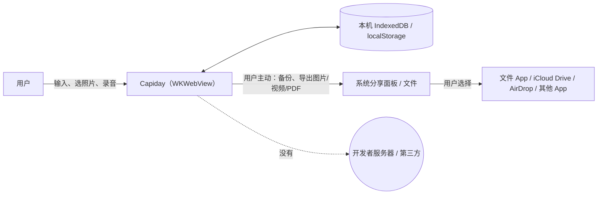

# Capiday 隐私与上架：技术事实清单（供产品负责人和合规核实使用）

> 2026-11-14。本文**只列技术事实**和需要核实的问题，**不做任何法律或合规结论**。最终决定和核实由产品负责人负责。
> 证据以 commit `0e950a8` 为准；做不到用代码确认的，标为【真机】或【待确认】。

## 1. 处理哪些数据（全部在用户设备上）

| 数据 | 内容 | 存在哪里 | 谁能访问 | 证据 |
|---|---|---|---|---|
| 手帐内容 | 标题、正文、页面版式、图层（文字、贴纸、照片框、手绘）、书本、标签、心情、日期 | App 内的 WebKit IndexedDB（`little-days-meta`），以及 localStorage 镜像 | 只有本机的 App | `meta-store.mjs:8-9`；`model.mjs:494-518` |
| 照片 | 用户选择的照片，重新编码成长边 1200 px 的 JPEG；**EXIF 和 GPS 被去掉** | IndexedDB（`little-days-media`） | 只有本机 | `app.js:12030-12054` |
| 视频、音频、录音 | 原始文件字节；**可能包含原文件里的元数据（例如位置）** | 同上 | 只有本机 | `app.js:12414` |
| 原始文件名 | 媒体记录里的 `name` | 同上；会写进备份文件 | 只有本机，以及用户导出的备份 | `app.js:12187` |
| 计划、习惯（隐藏中的功能） | 文字、打卡记录 | 手帐状态里 | 只有本机 | — |
| 个人资料 | 本地昵称和头像标记（不是账号） | localStorage `little-days.account` | 只有本机 | `account.mjs` |
| App 锁 | 4 位密码的加盐 SHA-256 散列、宽限时间、是否使用生物识别 | localStorage `little-days.lock` | 只有本机 | `app-lock.mjs:6, 76-79` |
| 设置偏好 | 语言、主题、提醒时间、隐私开关等 | localStorage `little-days.*` | 只有本机 | — |
| 使用事件日志 | 只记录白名单里的事件名和数字或短 id，**不记录正文、标题、文件名或媒体** | localStorage `little-days.events`（最多 600 条） | 只有本机；用户点「导出测试记录」时才生成文件 | `events.mjs:8-32` |
| Captain 聊天草稿 | 用户在 Captain 面板里输入的文字 | localStorage | 只有本机 | — |

## 2. 数据流（什么时候、去哪里）

- **网络**：App 只读取自己包内的 `shared/*.json`（通过自定义的 `littledays://` 来源）；`Public/` 里没有任何外部 URL【代码：`app.js:12179`】。
- **开发者能否看到用户数据**：不能。没有服务器、账号或上传。
- **第三方 SDK**：没有（没有统计、广告、崩溃上报或登录 SDK）。
- **本机 AI（开发用）**：只有当页面本身从本机 loopback 地址打开，并且带着开发参数时，才会连接本机的 `127.0.0.1:11434`。iPhone App 和在线链接**都不会**用到它【代码：`captain-ai.mjs:25, 48-76`】。
- **iCloud**：现在**没有使用**（没有 iCloud capability 或 entitlements）。如果用户自己把备份文件存到 iCloud Drive，这是系统文件面板的行为。iCloud 整机备份是否包含 App 的 WebKit 数据：【真机】。
- **离开设备的唯一途径**：用户主动备份或导出，然后通过系统面板选择目的地。

## 3. 权限和用途

| 权限 | Info.plist 键（已有的文案） | 什么时候请求 | 用途 | 拒绝后 |
|---|---|---|---|---|
| 相机 | `NSCameraUsageDescription`：「Capiday can use the camera to take photos for your journal.」 | 用户在照片选择菜单里选「拍照」时，由系统请求 | 拍一张照片放进手帐 | 可以从相册选择 |
| 麦克风 | `NSMicrophoneUsageDescription`：「Capiday uses the microphone to record voice notes.」 | 第一次开始录音时（`getUserMedia`，`app.js:12684`） | 录语音手帐 | 不能录音，其他功能不受影响 |
| Face ID | `NSFaceIDUsageDescription`：「Capiday uses Face ID to unlock your private journal.」 | 用户打开 App 锁并选择生物识别时 | 解锁 App 锁（iPhone Duo 上是 Touch ID，由外壳区分） | 用 4 位密码 |
| 通知 | 不需要 plist 键；由 `UNUserNotificationCenter` 请求 | 用户打开「每日提醒」时（`LittleDaysReminders.swift:35-46`） | 本地提醒，不经过服务器 | 不提醒 |
| 照片库 | **不需要**：用的是系统照片选择器（`<input type=file accept="image/*">`，`index.html:78-80`） | — | — | — |
| 文件 | `UIFileSharingEnabled` 和 `LSSupportsOpeningDocumentsInPlace` 都是 YES | — | 备份和导出出现在「文件」App 里 | Sprint 1 会改为放进 tmp 后交给系统面板 |

> 中文的权限说明文案：已经有了，在 `Native/App/zh-Hans.lproj/InfoPlist.strings` 里，包括：「开铺手帐可以用相机拍摄放进手帐的照片。」「开铺手帐用面容 ID 解锁你的私人手帐。」「开铺手帐需要麦克风来录制你的语音日记。」【代码】。iPhone Duo 用的是 Touch ID，这句「面容 ID」文案是否需要改成通用说法【待确认】。

## 4. 随 App 打包的第三方内容（不是服务，是素材）

| 内容 | 数量 | 许可证文件 | 说明 |
|---|---|---|---|
| 字体 | 11 | 各自的 OFL 许可证（例如 `LD-handwritten-OFL.txt`） | 开源字体许可，需要随 App 附上许可证（设置 → 开源许可已经有入口） |
| 图库照片 | 78 | `Unsplash-Photos.txt` | Unsplash 许可；是否需要署名、在中国区使用有没有特别限制：【待确认】 |
| 音乐 | 8 | `LittleDays-Original-Music.txt` | 原创 |
| 贴纸和美术素材 | 23 以上 | `LittleDays-Original-Assets.txt` | 原创 |

素材的来源和许可证以共享的 `library.json` 为准（AGENTS.md 有规定）。

## 5. 安全相关事实（不等于加密）

- App 锁只锁住界面，**不加密数据**。4 位密码只有一万种组合，散列保存在 localStorage【代码】。
- 文件保护：没有设置 `com.apple.developer.default-data-protection`，所以使用系统默认等级【代码；实际效果：真机】。
- 备份文件：明文（v1 是 JSON，以后的 `.capiday` 是不加密的 ZIP）。
- App 切换器：打开 App 锁时画面会被遮住；不开锁时不遮【代码：`LittleDaysWebShellView.swift:21-30`】。
- 加密出口申报：`ITSAppUsesNonExemptEncryption = NO`。Sprint 1 会使用 CryptoKit 的 SHA-256（散列，不是加密）。以后如果做「带密码的备份」，需要重新评估这项申报【待确认】。

## 6. 隐私政策需要的事实（供起草参考，不是政策文本）

1. 收集什么：开发者**不收集**任何数据；所有内容只保存在用户的设备上。
2. 设备上处理什么：见第 1 节。
3. 用途：只用于在 App 内创作和查看手帐。
4. 共享：不和任何第三方共享；只有用户自己主动导出或分享。
5. 保存期限：在用户删除内容或删除 App 之前一直保存。删除 App 会删除全部数据（用户应该先备份）。
6. 用户能做什么：查看和编辑全部内容，导出备份，删除内容，删除 App。
7. 安全措施：App 锁（界面锁）；数据保存在 iOS 的 App 沙盒里。
8. 儿童：App 不面向儿童收集信息（产品定位：不设年龄门槛）【待确认年龄分级】。
9. 联系方式：需要一个支持邮箱或页面【待提供】。
10. 变更：政策更新时在 App 内告知（更新记录）。
11. 将来如果加入 iCloud 备份或同步：数据存在用户自己的 iCloud 账号里，开发者无法访问；在中国大陆由云上贵州运营 iCloud【待确认表述】。

## 7. App Store「App 隐私」标签（技术依据）

- 按现在的代码，没有任何数据发送给开发者或第三方。技术上符合「不收集数据」的情况【需要合规确认最终的选项】。
- 需要新增的隐私清单 `PrivacyInfo.xcprivacy`：
  - `NSPrivacyTracking = false`；
  - `NSPrivacyCollectedDataTypes = []`；
  - `NSPrivacyAccessedAPITypes`：`UserDefaults`，理由 `CA92.1`（`LittleDaysReminders.swift:80-97`；`LittleDaysWebResources.swift:34`；`LittleDaysWebShellView.swift:237, 246`）。
  - 如果 Sprint 1 用到磁盘剩余空间的 API（`volumeAvailableCapacityForImportantUsage`），还要加上 `NSPrivacyAccessedAPICategoryDiskSpace`（理由待选，例如 `E174.1`）【待确认理由代码】。
  - 文件时间戳类 API：现在没有使用。

## 8. 中国大陆上架：待确认事项（不做结论）

| # | 事项 | 技术事实 | 需要谁确认 |
|---|---|---|---|
| 1 | App 备案（工信部 / ICP）是否适用于完全离线、没有服务器的 App，以及 App Store Connect 当时的要求 | 没有服务器、没有网络服务；名称「开铺手帐」 | 合规或法律顾问 |
| 2 | 个人信息保护法：隐私政策和权限告知的形式（首次启动是否需要弹出同意、单独同意的范围） | 没有收集，只在本机处理；权限都是使用时才请求 | 合规 |
| 3 | 中文的隐私政策和用户协议 | 需要起草 | 产品负责人和法务 |
| 4 | 中文的权限说明文案 | 已有 `zh-Hans.lproj/InfoPlist.strings`；Face ID 文案在 Touch ID 设备上是否合适 | 产品负责人 |
| 5 | 内置的图库照片（Unsplash）和字体在中国区的使用和署名 | 许可证文件都在包里 | 法务 |
| 6 | 将来的 iCloud 和 CloudKit：国区由云上贵州运营的告知方式 | 现在没有使用 | 合规 |
| 7 | 将来的 AI 小管家：境内服务方、算法备案或安全评估是否适用 | 现在没有接入，开关是禁用的 | 合规 |
| 8 | 商标和名称：「开铺手帐」和 Capiday 在两边的商标情况 | — | 产品负责人 |
| 9 | 年龄分级和内容（没有用户生成内容的公开分享，社区是隐藏的演示） | 社区、私信、协作在正式版隐藏 | 产品负责人 |

## 9. 美国上架：待确认事项

1. App 隐私标签选「不收集数据」是否成立（第 7 节）。
2. 隐私政策 URL，以及支持 URL。
3. 出口合规（第 5 节）。
4. 如果以后接入 iCloud：只放用户自己的数据，标签是否需要变化【待确认】。
