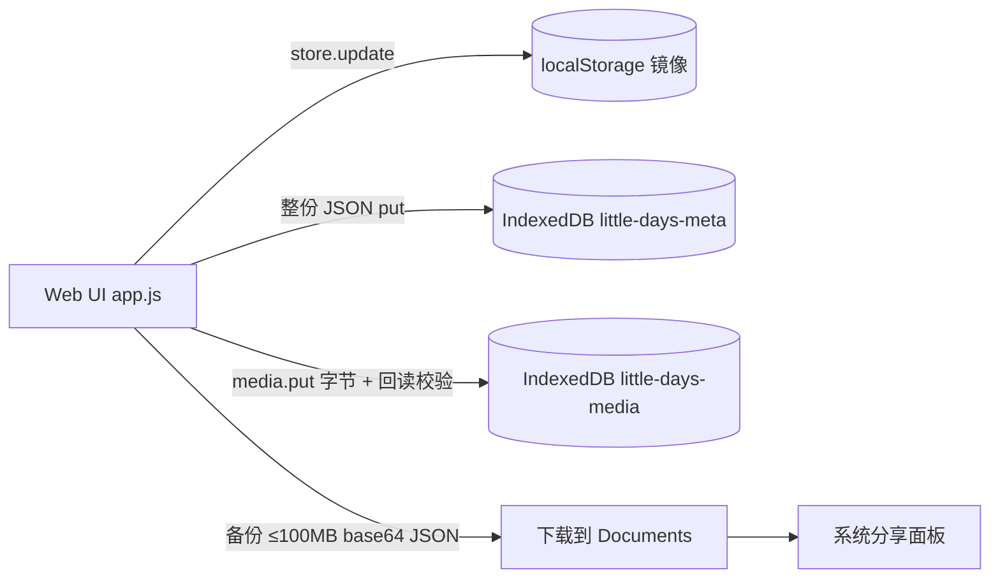
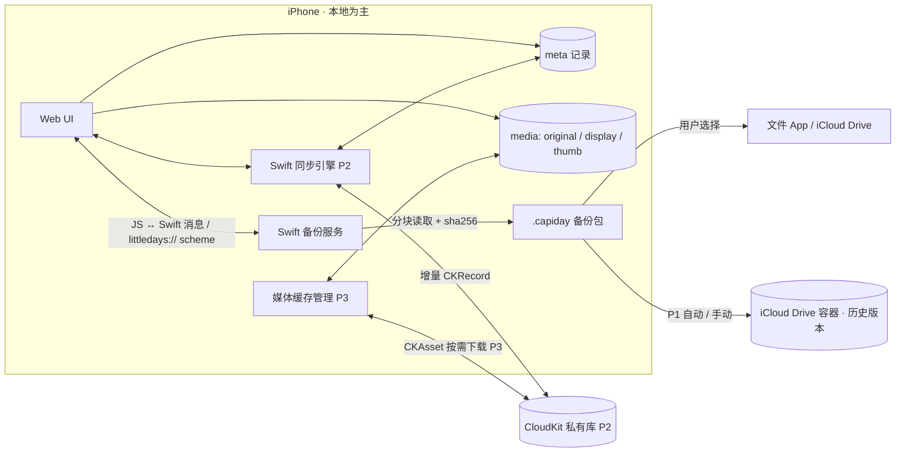

# Capiday 存储架构：Local-First + 可选 iCloud（架构审查与分阶段设计，等确认）

> 2026-11-14。本文只做架构审查和设计，**没有修改业务代码**，没有引入任何云服务，也没有迁移或删除数据。
> 现状判断都给了代码位置（以 commit `134dac0` 为准）；做不到用代码确认的，标为「需要真机验证」。
> 第 0 阶段的细节见 `docs/SPRINT1_BACKUP_RESTORE_PLAN.md`。
> 本文同时回答「iCloud Backup Architecture Planning」中的 10 个问题，见第 4 节。

## 1. 核对过的现状（代码证据）

| 已知信息 | 核对结果 | 证据 |
|---|---|---|
| iPhone 用 WKWebView 加 JavaScript | ✅ App 入口只加载 WebShell；旧的 SwiftUI `NativeStore` 原型没有被使用 | `Native/App/LittleDaysApp.swift:14`；`LittleDaysWebShellView.swift`；`NativeStore.swift:27` 不在启动路径上 |
| 手帐状态在 IndexedDB `little-days-meta` | ✅ 整份 JSON 放在 `kv` 的 `little-days.v1` 键下，写入会合并 | `Public/js/meta-store.mjs:8-9, 46-63` |
| 媒体在 IndexedDB `little-days-media` | ✅ 记录是 `{id, bytes: ArrayBuffer, mime, size, kind, name…}`，页面里只存 `media:<uuid>` 引用 | `Public/js/media.mjs:51, 67-97` |
| localStorage 保留部分镜像 | ✅ 先同步写 localStorage 镜像，再写 IndexedDB；镜像写不下时自动关闭镜像（`little-days.v1-mirror=off`）；设置、锁、提醒等都放在 localStorage | `model.mjs:494-518` |
| 照片压缩到 1200 px | ✅ `imageBlob` 用 canvas 重新编码：长边 1200、JPEG 0.84、单个最大 20 MB，同时去掉 EXIF 和 GPS | `app.js:12030-12054` |
| 视频、音频保存原始字节 | ✅ 不转码。视频最大 50 MB、音频最大 20 MB；**视频里原有的元数据（包括可能的位置信息）会保留** | `app.js:12414, 12453` |
| 备份媒体上限 100 MB | ✅ | `media.mjs:286-290, 433` |
| 没有云同步 | ✅ 唯一的网络请求是读取自身的 `shared/*.json`；本机 AI 只在开发时连接 loopback 地址 | `app.js:12179`；`captain-ai.mjs:25` |
| 删除 | 媒体库**没有删除接口**，所以不会误删，但也不会清理；删除页面只删除引用 | `media.mjs`（只有 put / get） |
| 写入可靠性 | `put` 之后回读校验字节数；Studio 返回和新建书本时检查 `media.missing`；元数据用 `stored()` 等待写入完成 | `media.mjs:84-93`；`model.mjs:470-492` |

## 2. 当前架构和目标架构

| 维度 | 现在 | 目标（Phase 3 之后） |
|---|---|---|
| 唯一的副本 | 这台 iPhone 的 WebKit 数据目录 | 本机为主；iCloud 里有备份（P1）和同步记录（P2）；原图可以只放在云端（P3，需要验证后才释放本地空间） |
| 状态的粒度 | 一整份 JSON | 按记录拆分：书、天、页、图层、媒体元数据，每条记录有自己的 id、修改时间和 tombstone |
| 媒体的表示 | 显示图（照片）或原始字节（视频、音频） | `original` / `display` / `thumb` 三种，按需生成，可以分别放在本地或云端 |
| 备份 | 手动 JSON，最多 100 MB | 流式备份包，没有上限并且可以校验；可选保存到 iCloud Drive，保留历史版本 |
| 同步 | 没有 | CloudKit 私有数据库，只增量同步，离线优先 |
| 用户能看到的状态 | 只有「上次备份」 | 每项内容清楚标明：仅在本机 / 已备份 / 已同步 / 原图在云端 |

## 3. 数据流（Mermaid）

### 3.1 现在



### 3.2 目标（Phase 0–3）



## 4. 分阶段设计

### Phase 0：完整备份与恢复、存储统计、可靠性测试

详见 `SPRINT1_BACKUP_RESTORE_PLAN.md`，这里只列回答：

- **怎样取消 100 MB 上限**：在 iPhone App 里改用 Swift 写的 `.capiday` 备份包（Apple Archive）。浏览器路径保留 v1 和上限。不改 IndexedDB 的结构。
- **大媒体怎样流式或分批备份**：每次只处理一个媒体、按 4 MB 分块从 JS 交给 Swift，Swift 一边写入一边计算哈希。备选方案是 scheme handler 直接接收 PUT 请求体（需要先做实验）。
- **怎样验证完整性**：manifest 记录每个文件的 sha256、大小和数量；打包后回读并逐项比对，是「成功」的唯一标准。
- **怎样安全恢复、避免覆盖**：预览、二次确认、写入前快照、媒体先写 state 后写、失败停止、可以撤销、按 sha256 去重。
- **怎样统计媒体占用**：先用 `navigator.storage.estimate()` 得到快速的总量；分类统计只在用户点开时用游标逐条读取 `size`，可以取消并缓存结果。详见 `docs/SETTINGS_IA_V2_PLAN.md` 第 2 节。
- **iOS 更新、卸载、换机**：真机清单第 12–15 项（Sprint 1 第 7 节）。

### Phase 1：可选的 iCloud Drive 备份

#### 4.1 iCloud Documents 是否适合当前架构

适合，作为**备份的保存位置**，而不是同步。

理由：
- 备份已经是一个完整、自包含的文件（`.capiday`）。iCloud Drive 只负责存放和上传这个文件，不需要改动 IndexedDB。
- 用户在「文件」App 里也能看到和管理这些备份，透明，并且可以转移。

不用 iCloud Drive 做的事：
- 不把 IndexedDB 直接放进 iCloud，那样会产生冲突。
- 不用它做双向同步（Phase 2 用 CloudKit）。

#### 4.2 Xcode capability 和 entitlements

- Signing & Capabilities → **iCloud** → 勾选 **iCloud Documents**，Container 填 `iCloud.com.capiday.app`。
- 生成的 entitlements：
  - `com.apple.developer.icloud-container-identifiers = [iCloud.com.capiday.app]`
  - `com.apple.developer.icloud-services = [CloudDocuments]`
  - `com.apple.developer.ubiquity-container-identifiers = [iCloud.com.capiday.app]`
- Info.plist（工程现在用 `INFOPLIST_KEY_*` 生成，`NSUbiquitousContainers` 需要改成单独的 Info.plist，或者在 Build Settings 里追加）：

```xml
<key>NSUbiquitousContainers</key>
<dict>
  <key>iCloud.com.capiday.app</key>
  <dict>
    <key>NSUbiquitousContainerIsDocumentScopePublic</key><true/>
    <key>NSUbiquitousContainerName</key><string>Capiday</string>
    <key>NSUbiquitousContainerSupportedFolderLevels</key><string>Any</string>
  </dict>
</dict>
```

- 当前工程**没有任何 `.entitlements` 文件**（`project.pbxproj` 里没有 `CODE_SIGN_ENTITLEMENTS`），这一阶段会第一次加入。
- 同时建议加上 `com.apple.developer.default-data-protection = NSFileProtectionComplete`（见发布审查）。是否会影响后台备份（锁屏后文件不能读），需要评估，见 4.6。

#### 4.3 Swift 和 WKWebView 之间交换备份数据

- 和 Phase 0 是同一条通道：JS 把媒体分块交给 `LittleDaysBackup.swift`。iCloud 只是在 Swift 侧多了一个「保存位置」，**JS 代码不需要知道 iCloud 的存在**。
- 恢复时也一样：Swift 从 iCloud 下载完成并校验以后，JS 通过 `littledays://restore/…` 拉取。

#### 4.4 安全地保存多个版本、原子写入、失败重试

- 目录：`<container>/Documents/Backups/`，文件名 `Capiday-Backup-<ISO时间>-<设备短名>.capiday`。
- 写入步骤：
  1. 先在本地 tmp 生成并回读校验。
  2. 用 `NSFileCoordinator(writingItemAt:options:.forReplacing)` 复制到容器里的 `*.partial` 文件。
  3. 再用 `FileManager.replaceItemAt` 或改名，换成正式名称。这样 iCloud 里只会出现完整的文件。
- 历史版本：保留最近 **3 份完整备份**，加上每个月的第一份（最多 6 个月）。
  - 只有新的一份**确认已经上传**以后，才删除最旧的那份。
  - 不完整的备份不计入保留数量，也不会挤掉完整的备份。
- 重试：上传失败时由系统继续重试。我们在 App 回到前台时再检查状态，最多显示 3 次提醒；**不会无限地重新生成备份**。

#### 4.5 「本地备份完成」和「已上传到 iCloud」的区分

状态机：`本地已生成` → `已写入 iCloud 容器（等待上传）` → `已上传到 iCloud` / `上传失败（原因）`。

- 判断方法：用 `URLResourceValues` 里的 `ubiquitousItemIsUploaded`、`ubiquitousItemIsUploading`、`ubiquitousItemUploadingError`，或者 `NSMetadataQuery`（`NSMetadataUbiquitousItemIsUploadedKey`、`…PercentUploadedKey`）。
- **只有 `isUploaded == true` 才显示「已备份到 iCloud」**；在那之前显示「等待上传（需要网络）」。
- 其他设备是否能看到这个文件、能否下载，要用第二台设备实测，见验收清单。

#### 4.6 iCloud 未登录、空间不足、网络断开

| 情况 | 检测 | 处理 |
|---|---|---|
| 没有登录，或 iCloud Drive 已关闭 | `FileManager.default.ubiquityIdentityToken == nil`；在后台线程调用 `url(forUbiquityContainerIdentifier:)` 返回 nil | 开关不能打开，旁边说明「需要在系统设置中登录 iCloud 并打开 iCloud Drive」；本地备份照常可用 |
| 中途切换了 Apple ID | 监听 `NSUbiquityIdentityDidChange` | 停止自动备份，提示用户重新确认 |
| iCloud 空间不足 | `ubiquitousItemUploadingError`（配额相关错误） | 显示「iCloud 空间不足，备份只保存在本机」，不删除任何旧备份 |
| 断网 | 上传状态一直停在 uploading | 「等待上传」；回到前台时重新检查；不会删除旧版本 |
| 后台执行 | `BGProcessingTask`（需要 `BGTaskSchedulerPermittedIdentifiers`） | **不保证**按时运行。界面不写「每天自动备份」，只写「会在合适的时候尝试」，并始终显示上次成功的时间 |
| iCloud 出问题 | — | 日记照常使用：iCloud 的所有操作都在独立的队列里，失败只影响备份状态，不影响写日记 |

#### 4.7 手动和自动的交互

- 设置 → 数据与存储 → 备份：
  - 「立即备份」：本地 + iCloud（如果已开启）。
  - 「自动备份到 iCloud」开关，默认关闭，开启前说明会占用多少空间。
  - 最近一次「已上传」的时间。
  - 「历史版本」：列出 iCloud 里的备份，可以查看或恢复。
- 自动规则：自上次以来有新内容，而且距离上次超过 24 小时，在 App 进入后台时尝试一次（`beginBackgroundTask`），同时注册一个 `BGProcessingTask`（要求连接电源和网络）。
- **不会把 iCloud 当成唯一的备份**：界面上始终保留「导出到其他位置」；每 3 个月提醒一次「另外再存一份」（可以关闭）。

#### 4.8 恢复：预览、确认、防止覆盖

- 「从 iCloud 恢复」：列出版本（时间、设备、天数、媒体数、大小、是否完整）。
- 选中以后，如果文件还没下载到本机，先下载（显示进度，用 `startDownloadingUbiquitousItem`），然后校验，再进入 Phase 0 的预览和确认流程（快照、可撤销）。
- 新设备的第一次启动：如果检测到 iCloud 里有 Capiday 的备份，首页显示一个轻提示「在 iCloud 里找到 3 份备份，要恢复吗？」。不自动恢复。

### Phase 2：CloudKit 增量同步（只做设计，不实施）

#### 4.9 把整份 JSON 逐步拆成可以同步的记录

- 第一步（不改存储）：在 JS 里定义一个「记录视图」——从现有 state 推导出记录：`Book`、`Day`（entry）、`Page`（moment）、`MediaRef`、`Habit`、`Plan`。每条记录 = `{type, id, parentId, fields, modifiedAt, deviceId}`。
- 第二步：给需要的对象补上**稳定 id**。
  - 页面（moment）已经有 id；书有 id；天用 `date` 加书来标识（entry 也有 `id`）。
  - 图层有 id，但是作为 Page 记录的一部分同步（页面内的版式是一个整体，避免一页内的冲突难以合并）。
  - 媒体的 id 已经是稳定的 UUID。
- 第三步：本地记录一份「变更日志」（`changes` 对象存储，或一个 append-only 的键），每次 `store.update` 时对比前后两份记录视图，得出增量。这需要升级 meta 数据库的版本，**等 Phase 2 实施时再做**。

#### 4.10 增量同步、冲突、删除

- 同步引擎放在 Swift：`CKSyncEngine`（iOS 17 起提供，最低版本正好满足），私有数据库，自定义 zone `capiday`。
- 冲突：
  - 以**页面为单位**，后写入的覆盖先写入的（比较 `modifiedAt` 和 `deviceId`）。被覆盖的那个版本保存为「冲突副本」页面（标题后面加上「另一台设备的版本」），**不会悄悄丢掉**。
  - 书的元数据按字段合并。
- 删除：tombstone 记录（`deletedAt`），保留 30 天，作为回收站（见发布审查 P1）。媒体在没有任何引用并且超过 30 天以后，才进入「可以清理」状态。
- 避免重复上传媒体：`CKAsset` 用媒体 id 加 sha256 作为记录名；上传前先查询，已经存在就跳过。

#### 4.11 是否适合用 CloudKit private database

适合：没有服务器成本，数据在用户自己的 iCloud 里，开发者看不到内容，隐私标签可以继续写「不收集数据」。
限制：
- 只能在 Apple 设备上使用；
- 单个 Asset 和配额受用户的 iCloud 空间限制；
- **中国大陆的 iCloud 由云上贵州运营**，需要实测可用性和性能。

### Phase 3：云端媒体存储与本地缓存（只做设计）

- 三种表示：`original`（可选，Sprint 2）、`display`（长边 1200–2048）、`thumb`（长边 320，可以随时重新生成）。
- 本地保留策略：最近 90 天和用户收藏的页面保留 `display`；`original` 默认只在 iCloud 上（用户开启「优化本地存储」时才这样做）。
- 释放缓存的前提（三个条件同时满足）：
  1. CloudKit 确认这个 asset 已经上传；
  2. 重新下载一次并校验 sha256，结果一致；
  3. 最近 7 天内没有失败的记录。

  **只要缺一个条件，就不释放本机唯一的副本。**
- 离线访问：只有缩略图时，显示缩略图和「需要网络才能查看原图」；导出高清图片时如果需要原图，先下载。
- 用户控制：「数据与存储」里的「优化 iPhone 存储空间」开关（默认关闭），以及「立即下载全部原图」。

## 5. 不破坏旧数据的兼容策略

1. 所有新字段都是可选的（`originalRef`、`skin`、`peaks` 都是这样处理的）；Swift 模型同步加可选字段。
2. 不重写旧记录：只有用户修改过的页面才会写入新字段。
3. 增加新的存储结构时（变更日志、媒体元数据索引），只**新增**对象存储，不修改现有的 `kv` 和 `media`；数据库版本升级时 `onupgradeneeded` 只做新建，不做迁移。
4. 任何「清理」都分两步：先标记，显示给用户，再执行；而且要以有可以验证的备份为前提。
5. `schemaVersion` 继续是 1，直到出现真正不兼容的变化。届时引入迁移框架：迁移前快照、迁移后校验、失败回退（见发布审查 P0-3）。

## 6. 新增模块和建议的接口

| 模块 | 位置 | 接口（草案） |
|---|---|---|
| `LittleDaysBackup` | Swift | `begin(meta) -> token`；`appendState(token, chunk)`；`appendMedia(token, id, seq, data)`；`endMedia(token, id, size) -> sha256`；`finish(token, manifest) -> PackageURL`；`verify(url) -> Report`；`openForRestore(url) -> token, manifest` |
| `LittleDaysCloudBackup`（P1） | Swift | `availability() -> .ok / .signedOut / .driveOff`；`save(packageURL) -> .pending / .uploaded / .failed(error)`；`list() -> [Version]`；`download(version) -> URL`；`prune(keep:)` |
| `backup-v2.mjs` | JS | `buildManifest(state, mediaRecords)`；`streamBackup(bridge, state, media, onProgress)`；`previewSummary(manifest, currentState)` |
| `storage-stats.mjs` | JS | `estimate()`（快）；`breakdown({signal, onProgress})`（慢，可以取消）；结果缓存，见 `SETTINGS_IA_V2_PLAN.md` 第 2 节 |
| `sync-records.mjs`（P2） | JS | `recordsOf(state)`；`diff(prev, next) -> changes`；`apply(state, remoteChanges) -> state, conflicts` |
| `LittleDaysSync`（P2） | Swift | 封装 `CKSyncEngine`，和 JS 之间只交换「记录」，不交换整份 JSON |

## 7. 存储容量和性能估算（估算值，需要实测）

| 项目 | 估算 |
|---|---|
| 一张显示图 | 0.2–0.45 MB |
| 一页（3 张照片） | 约 1 MB；带视频的页面另加 10–50 MB |
| 一年每天一页 | 显示图约 0.3–0.5 GB；视频视使用情况而定，可能 1–5 GB |
| 加上原图 | 照片部分 ×5–15 |
| state JSON | 每页约 2–5 KB，一年 1–2 MB。整份写入的耗时随大小线性增加，需要在 1000 页以上的合成数据上实测（R7） |
| v1 备份 | 媒体 ×1.33（base64），并且要在内存里拼成一个字符串 |
| v2 备份 | 媒体 ×1.0；内存约为一个媒体的大小加上 8 MB；速度主要取决于 JS 与 Swift 之间的传输（base64 方案的吞吐量需要实测，目标每秒 30 MB 以上） |

## 8. 每个阶段的验收标准

| 阶段 | 自动化 | 真机 |
|---|---|---|
| P0 | 单元测试：manifest、分块、去重映射、mime。浏览器测试：v1 回归、恢复预览和撤销。XCTest：打包、解包、哈希、篡改检测 | Sprint 1 第 7 节的 1–15 项 |
| P1 | XCTest：版本保留规则、状态机（模拟上传状态） | 未登录、空间不足、断网、切换 Apple ID；两台设备看到同一份备份；美区和国区 Apple ID 各测一次 |
| P2 | 记录 diff 和 apply 的属性测试；冲突副本测试；tombstone 测试 | 两台设备离线各自编辑同一页，联网后得到冲突副本、什么都没有丢；删除后 30 天内可以恢复 |
| P3 | 释放缓存的三个前提条件分别测试 | 开启「优化存储」后断网浏览、重新下载、导出高清；空间统计和实际相符 |

## 9. 中美两个市场

| 方面 | 美国 | 中国大陆 | 说明 |
|---|---|---|---|
| 本地功能 | ✅ | ✅ | 完全通用，不依赖网络 |
| iCloud Drive 和 CloudKit | 由 Apple 运营 | 由云上贵州运营（Apple 的条款） | 两边的 API 相同；**国区的可用性和速度需要用国区 Apple ID 在真机上验证** |
| 隐私标签 | 只在本机加用户自己的 iCloud，可以写「不收集数据」 | 同时需要中文的隐私政策和个人信息处理说明（PIPL）。境内上架的 **App 备案要求需要专业人士确认** | 如果以后接入开发者自己的服务器或第三方 AI，需要重新评估 |
| 第三方 AI 和云服务 | — | 需要境内的服务方和备案 | 设计上保持可以替换：`captain-ai.mjs` 已经是 Provider 接口；所有对外请求放在一个可以按地区切换的适配层后面，默认关闭，只发送用户明确选择的内容 |

## 10. 现在最值得先做的三件事

1. **S1-1：恢复安全**——修 mime 正则，加恢复前快照和「撤销恢复」。只改 JS、风险最低，立刻消除「能备份却恢复不了」和「恢复后无法回退」两个风险。
2. **S1-2 和 S1-3：流式备份包和回读校验**——取消 100 MB 上限，并且让「成功」可以验证。这是 Phase 1 iCloud 和 Sprint 2 原图的前提。
3. **真机行为调查**（Sprint 1 清单第 12–15 项）：TestFlight 更新、iCloud 整机备份、换机、卸载。结论直接决定设置里的说明怎么写，也决定 iCloud 备份的优先级。

## 11. 需要产品负责人决定的事

1. 备份包格式：`.capiday`（推荐），还是分卷 JSON。
2. Phase 1 的「自动备份到 iCloud」是否放进首个正式版。推荐放到首发之后的第一个版本：先让手动的流式备份在真机上稳定。
3. Phase 2 和 Phase 3 是否进入路线图，或者等出现真实的多设备需求时再启动（推荐后者，避免过度设计）。
